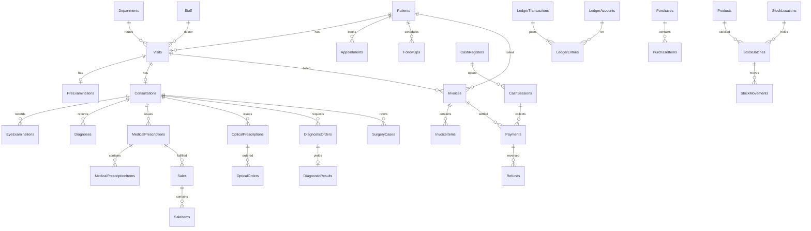

# طراحی دیتابیس — MySQL 8.4 / InnoDB / utf8mb4

## قواعد عمومی

- کلید اصلی `BIGINT` برای جدول‌های پرحجم، `INT` برای مرجع‌ها. شماره‌های انسانی (پرونده، فاکتور) ستون جدا و Unique دارند.
- زمان ثبت به UTC در `DATETIME(6)`؛ نمایش در Frontend با `Asia/Kabul`. تاریخ‌های تقویمی (تاریخ تولد، تاریخ نوبت) با `DATE`.
- پول `DECIMAL(18,2)`؛ نرخ تبدیل `DECIMAL(18,6)`؛ مقدار جنس `DECIMAL(18,3)`.
- Foreign Key با `ON DELETE RESTRICT`. Cascade فقط برای آیتم‌های داخلی سند پیش از نهایی‌شدن.
- `Version INT` به‌عنوان Concurrency Token برای داده‌های قابل ویرایش.
- حذف فیزیکی سوابق طبی و مالی از رابط عادی ممکن نیست؛ لغو با وضعیت، اصلاح با اصلاحیه.
- همه تغییرات با EF Core Migration نسخه‌بندی می‌شوند.

## تفاوت پیاده‌سازی با طرح اولیه

جدول‌های واقعی در Migrationهای `backend/src/AlShifa.Api/Infrastructure/Migrations` مرجع نهایی‌اند. تصمیم‌های ساده‌سازی:

| طرح اولیه | پیاده‌سازی |
|---|---|
| `EyeExaminations` | ستون‌های `FindingsOd` و `FindingsOs` در `Consultations` تا تأیید M-2 |
| `Suppliers` | نام تأمین‌کننده به‌صورت متن در `Purchases` |
| `ProductCategories`, `Units` | متن در `Products` |
| `Currencies`, `ExchangeRates` | ساخته نشده، منتظر F-1 |
| `Notifications` | ساخته نشده؛ اعلان فقط از SignalR |
| Unique روی `StockBatches` | Unique نیست؛ `FindOrCreateBatch` با قفل سطر و تفکیک قیمت خرید |
| یک جلسه باز برای هر صندوق | ستون تولیدی `OpenRegisterKey` با Unique |
| `NumberSequences` | داخل تراکنش فراخوان؛ با Rollback شماره برمی‌گردد و بی‌فاصله می‌ماند |

## ERD کلی

## جدول‌ها

### Core
| جدول | نکات کلیدی |
|---|---|
| `Patients` | `FileNumber` Unique؛ نام، نام پدر، جنسیت، `BirthDate` یا `EstimatedBirthYear`، تماس، آدرس؛ Index روی نام و تماس؛ `Version` |
| `PatientChangeLogs` | تاریخچه تغییر هویت (ستون، قدیم، جدید، کاربر، زمان) |
| `Departments` | بخش‌ها |
| `Staff` | مشخصات، بخش، فعال/غیرفعال؛ `UserId` اختیاری و Unique |
| `Visits` | `VisitNumber` Unique؛ `PatientId`، `DepartmentId`، `DoctorStaffId`، وضعیت، علت، `VisitDate`؛ Unique روی (`VisitDate`,`QueueScope`,`QueueNumber`)؛ `Version` |
| `VisitStatusHistory` | هر انتقال وضعیت با کاربر و زمان |
| `Appointments` | مریض، داکتر، تاریخ/زمان، وضعیت؛ Unique روی (`DoctorStaffId`,`ScheduledAt`) برای نوبت‌های فعال با ستون تولیدی |
| `NumberSequences` | شمارنده اتمیک شماره اسناد و صف: (`Scope`,`Period`) Unique |

Identity: جدول‌های استاندارد `AspNetUsers`، `AspNetRoles`، `AspNetUserRoles`، ... و صلاحیت‌ها در `AspNetRoleClaims` با نوع `permission`.

### Clinical
| جدول | نکات کلیدی |
|---|---|
| `PreExaminations` | Unique روی `VisitId`؛ شکایت اصلی، سابقه، VA/IOP برای OD و OS، یادداشت؛ `Version` |
| `Consultations` | Unique روی `VisitId`؛ داکتر، پلان، یادداشت محرمانه، `FinalizedAt`؛ `Version` |
| `EyeExaminations` | Unique روی (`ConsultationId`,`Eye`) با Eye=OD/OS |
| `Diagnoses` | تشخیص‌ها؛ `Eye` اختیاری |
| `ClinicalAmendments` | اصلاحیه روی سند نهایی (منبع، متن قدیم/جدید، دلیل، کاربر) |
| `MedicalPrescriptions` / `MedicalPrescriptionItems` | `RxNumber` Unique؛ دوا، مقدار، روش، مدت **فقط طبق ورودی داکتر**؛ `DispensedQty` |
| `OpticalPrescriptions` | Sphere/Cylinder/Axis/ADD برای OD و OS، PD |
| `DiagnosticTests` | فهرست قابل تنظیم، وصل به `Services` |
| `DiagnosticOrders` | `OrderNumber` Unique؛ `VisitId` اختیاری برای مستقل؛ وضعیت؛ `Version` |
| `DiagnosticResults` | Unique روی `DiagnosticOrderId`؛ متن، انجام‌دهنده، زمان |
| `SurgeryCases` | نوع، داکتر، تاریخ، وضعیت، بررسی پیش‌عملیات، گزارش، وضعیت پس از عملیات؛ `Version` |
| `FollowUps` | تاریخ پیگیری و وضعیت |
| `ClinicalAccessGrants` | Break-glass: کاربر، مریض، دلیل، انقضا |

### Financial
| جدول | نکات کلیدی |
|---|---|
| `Services` | خدمت، بخش، فعال |
| `ServicePrices` | قیمت با `EffectiveFrom`؛ تغییر قیمت فاکتور گذشته را تغییر نمی‌دهد |
| `Invoices` | `InvoiceNumber` Unique؛ مریض/مراجعه اختیاری؛ جمع، تخفیف، پرداخت‌شده؛ وضعیت؛ `Version` |
| `InvoiceItems` | قیمت **کپی‌شده** در زمان صدور؛ `SourceType`,`SourceId`؛ `ActiveSourceKey` تولیدی و Unique برای جلوگیری از هزینه تکراری |
| `Payments` | `ReceiptNumber` Unique؛ `IdempotencyKey` Unique؛ روش، مبلغ، `CashSessionId` |
| `Refunds` | مبلغ، دلیل، تأییدکننده؛ مجموع برگشت ≤ پرداخت |
| `CashRegisters` / `CashSessions` | یک جلسه باز برای هر صندوق با ستون تولیدی Unique؛ مبلغ شروع، مبلغ شمارش‌شده، اختلاف |
| `LedgerAccounts` | سرفصل‌ها |
| `LedgerTransactions` | یک رویداد مالی؛ `SourceType`,`SourceId`,`Kind` Unique؛ `ReversalOfId` |
| `LedgerEntries` | Debit/Credit؛ مجموع هر تراکنش صفر؛ **غیرقابل ویرایش** |
| `Expenses` | مصارف؛ `Version` |
| `Currencies` / `ExchangeRates` | واحد پول و نرخ (نیازمند تأیید F-1) |

### Inventory
| جدول | نکات کلیدی |
|---|---|
| `ProductCategories`, `Units` | مرجع |
| `Products` | نوع (Drug/Frame/Lens/General)، کد Unique، حداقل موجودی، قیمت فروش |
| `StockLocations` | دواخانه، عینک، گدام مرکزی |
| `StockBatches` | Unique روی (`ProductId`,`LocationId`,`LotNumber`,`ExpiryDate`)؛ `CHECK (Quantity >= 0)` |
| `StockMovements` | نوع، مقدار علامت‌دار، `SourceType`,`SourceId`؛ غیرقابل ویرایش |
| `Suppliers`, `Purchases`, `PurchaseItems` | خرید و ورود موجودی |
| `Sales`, `SaleItems` | `SaleNumber` Unique؛ `Kind`؛ نسخه اختیاری؛ `IdempotencyKey` Unique |
| `OpticalOrders` | نسخه اختیاری، فریم، عدسی، وضعیت؛ `Version` |

### System
| جدول | نکات کلیدی |
|---|---|
| `AuditLogs` | کاربر، عمل، موجودیت، شناسه، قدیم/جدید بدون اسرار، IP، زمان؛ فقط افزودنی |
| `Notifications` | اعلان ماندگار کاربر |
| `OutboxEvents` | نوع، Payload فقط شناسه، Group، `ProcessedAt`؛ Index روی `ProcessedAt` |
| `IdempotencyKeys` | (`UserId`,`Key`) Unique؛ هش درخواست، پاسخ ذخیره‌شده |
| `Attachments` | نام امن روی دیسک، نوع، حجم، هش؛ دسترسی فقط از API |
| `Settings` | کلید/مقدار |

## تضمین‌های هم‌زمانی

| خطر | راه‌حل دیتابیس |
|---|---|
| دریافت تکراری | `IdempotencyKey` Unique روی `Payments` + قفل سطر فاکتور در تراکنش |
| پرداخت بیش از مانده | `SELECT ... FOR UPDATE` روی فاکتور |
| فروش بیش از موجودی | `UPDATE StockBatches SET Quantity = Quantity - @n WHERE Id=@id AND Quantity >= @n` + `CHECK` |
| شماره تکراری | `NumberSequences` با `INSERT ... ON DUPLICATE KEY UPDATE Value = LAST_INSERT_ID(Value + 1)` + Unique نهایی |
| ویرایش هم‌زمان | `Version` و پاسخ HTTP 409 |
| هزینه تکراری | `ActiveSourceKey` Unique |
| دو جلسه باز صندوق | ستون تولیدی Unique |
| تراکنش نامتوازن | تولید فقط از `LedgerService` با بررسی صفر بودن |

## گزارش‌ها

همه گزارش‌ها مستقیم از جدول‌های اصلی با Index مناسب خوانده می‌شوند. جدول تکراری گزارش ساخته نمی‌شود.
